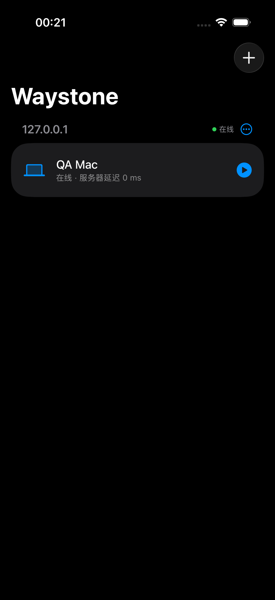
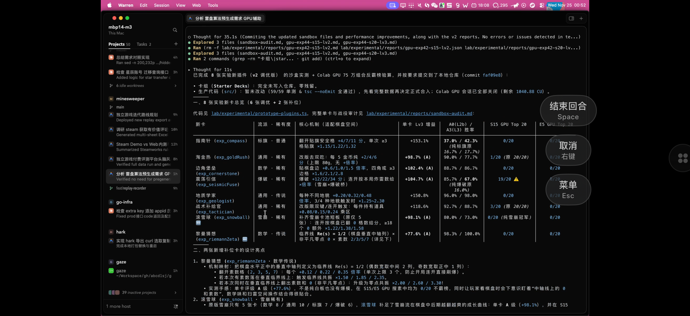
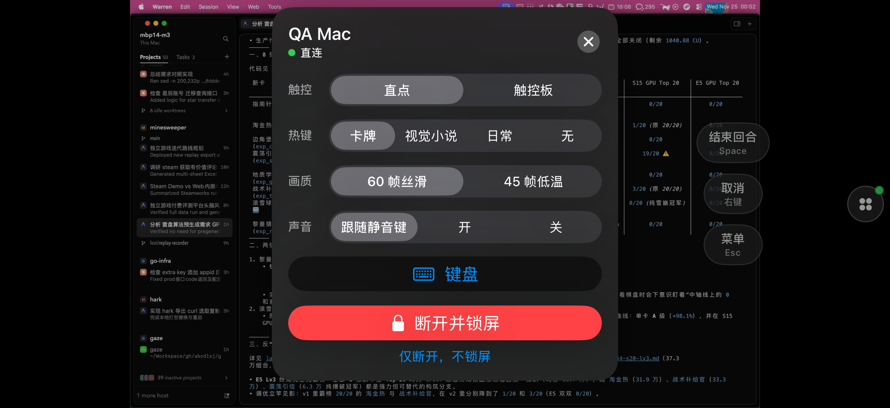
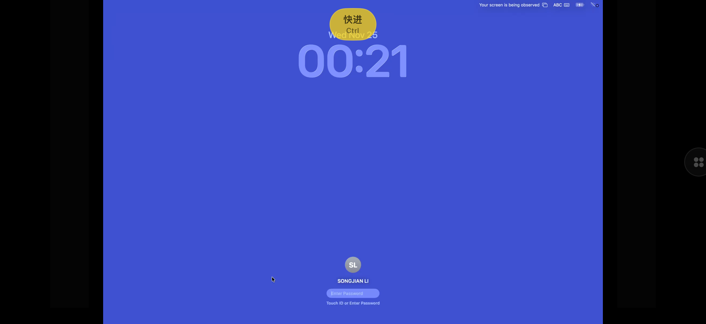
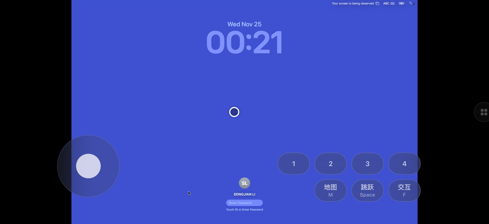
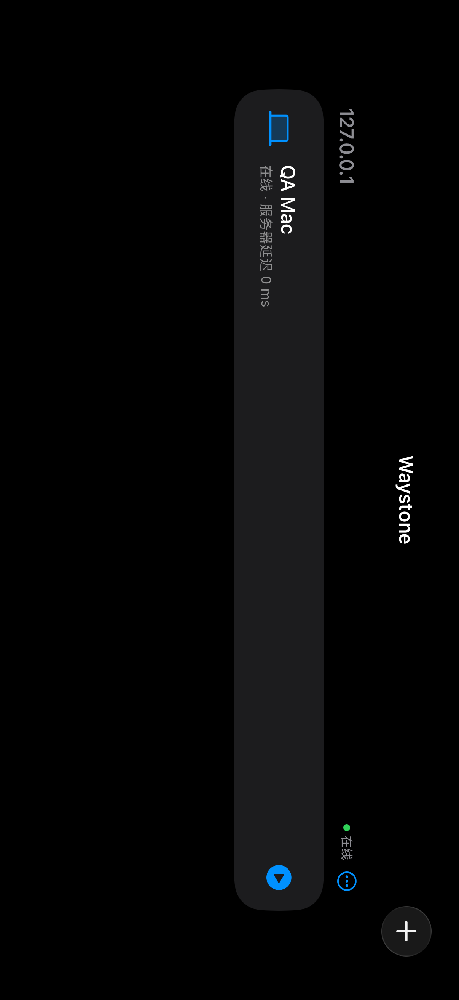

# Waystone 验收报告

> 验收日期：2026-11-25。环境：MacBook（Apple Silicon，macOS 26.4）、iPhone 17 Pro 模拟器（iOS 26.4）。
> 范围：用户要求的「检查并重写半成品、补齐功能、模拟器验收」。Windows 被控端不在本次范围内，见第 5 节。

## 1. 结论

| 项 | 结果 |
|---|---|
| Rust 全量测试 | 123 个，全部通过；连跑 4 次无偶发失败 |
| `cargo clippy --workspace --all-targets` / `cargo fmt --check` | 干净 |
| iOS 单元测试 | 32 个，全部通过 |
| iOS 端到端验收（XCUITest，真实服务端 + 真实被控端） | 通过，约 45 秒 |
| iOS 编译警告 | 0 |

端到端链路在模拟器上全部走通：首页发现主机 → 点主机进串流 → 出画面 → 直点和触控板手势 → 三套热键 → 控制面板 → 挂断回首页。被控端日志收到了每一个手势对应的输入事件（第 3 节）。

有一项没验证到：输入事件**注入到 macOS 屏幕**的效果。验收时被控端二进制没有辅助功能权限，CGEvent 会被系统丢弃。解码和状态机已验证，注入这一步需要你授权后自己看一次（第 6 节）。

## 2. 审查与重写了什么

原实现能出画面，但结构和正确性问题较多。处理原则：能修的修，结构不对的整块重写。

### 2.1 协议（`waystone-proto`）

- 键码统一为 USB HID usage，iOS 和被控端各自映射，不再各用一套私有码。
- `video_codec` 从字符串改为枚举 `VideoCodec`（h264 / h265）。
- 新增 `TurnCredentials.relay_bitrate_ceiling`、`PeerState.busy`、`ByeReason::PeerOffline`。
- 滚轮单位定为像素，正 `dy` 表示向上。

### 2.2 iOS 控制端（重写）

按职责分层，层与层之间只通过协议或值类型通信：

| 层 | 内容 |
|---|---|
| `App/` | 根视图、`AppModel`（服务器池、会话、配对、前后台切换）、DEBUG 注入钩子、日志分类 |
| `Protocol/` | 线上 JSON（显式 snake_case 键）、二进制输入帧、配对链接解析 |
| `Pool/` | 实例存储、设备身份、证书指纹固定的 WSS、`PoolConnection`（主机列表、退避重连、配对与认证共用一个连接、按会话 id 路由消息） |
| `Stream/` | `StreamSession`（connecting / live / stalled / ended 四阶段、健康检查、断开原因归因）、`Transport`（Rust C ABI）、媒体管线 |
| `Input/` | `PictureGeometry`（等比适配、缩放平移、坐标换算）、`DirectTouchEngine` / `TrackpadEngine` 两套手势状态机、`InputController`（持有所有按下的键和按钮，可一次性全部释放）、热键预设（纯数据） |
| `Media/` | VideoToolbox 解码（最多 2 帧在途、落后时跳过非关键帧）、AVAudioEngine Opus 播放、Metal 渲染 |
| `UI/` | 首页、扫码配对、串流页、悬浮球、控制面板、软键盘 |

修掉的正确性问题（节选）：

- 解码器构造格式描述时传了悬空指针。
- Metal 纹理在 GPU 用完之前就被释放。
- 音频环形缓冲没有加锁。
- 主机列表和会话消息挤在一个回调里，会话切换时会串台。
- 手指移动全部被丢掉（本轮验收发现，第 4 节）。

按设计文档补齐的体验：

- 手势（5.2）：
  - 160 ms 内抬手是点击。
  - 提前移动是悬停，抬手绝不点击，防误出牌。
  - 按住 160 ms 是抓取拖拽。
  - 双指 200 ms 内轻点是右键。
  - 双指平移是滚动，捏合是本地放大。
- 触控板模式：相对移动带加速，有本地光标环，光标先于视频跟手。
- 热键（5.3）：卡牌 / 视觉小说 / 日常三套预设加「无」，都是纯数据定义，加一套预设不用改视图代码。
- 悬浮球：36 pt，3 秒不动自动半藏，可拖动，松手吸附到最近的边，颜色表示连接质量。
- 控制面板：触控方式、热键、画质（60 / 45 fps）、声音（跟随静音键 / 开 / 关）、键盘、断开并锁屏、仅断开。
- 弱网（5.4）：卡顿 3 秒显示顶部小横幅并保留最后一帧，12 秒结束会话，并说明原因（网络、主机离线、主机出错等）。

### 2.3 macOS 被控端（重写）

- `agent`：信令和会话的主循环。
- `session`：一次会话的完整生命周期。
- `capture`：屏幕采集。
- `input`：输入注入线程，最短按住 15 ms，处理连击计数和修饰键，能一次性全部释放。
- `keymap`：HID 键码到 macOS 虚拟键码。
- `plan`：编码分辨率和码率。保持桌面宽高比，不超过面板像素，长边最大 3840；码率按像素数 × 帧率缩放。
- `system`：锁屏、扬声器静音、权限检查。

Swift 侧分成采集、编码、Opus、注入、系统五个文件，由 `build.rs` 编成一个静态库。

补齐的行为：

- 画面静止 500 ms 后以 5 fps 保活，后接入的控制端不会黑屏。
- 掉线后保留 10 秒重连窗口。
- 断开时按固定顺序收尾：释放输入 → 停采集 → 关引擎 → 恢复扬声器 → 按原因决定是否锁屏。
- 走中继时码率钳到服务端下发的上限。
- 同时到达的多个关键帧请求合并为一个，间隔 250 ms。

### 2.4 传输与服务端

- `waystone-rtc`：
  - 修了 STUN `MESSAGE-INTEGRITY` 和 IPv6 XOR 地址。
  - 重写 TURN 客户端，新增仅中继模式。
  - 保证 `ws_engine_stop` 之后不再有回调。
- `waystoned`：
  - 管理员口令：一次性认领，Argon2id 哈希，cookie 会话。
  - `waystoned pair` 子命令，直接从数据目录生成配对链接。
  - 浏览器请求校验同源。
  - 主机被占用时拒绝新会话；只接受会话参与者发来的会话消息；吊销设备会立即断开它的连接；测量 RTT。
  - 自动选择 LAN 地址。
  - 新增 Dockerfile 和运维 README（`crates/waystoned/README.md`）。
  - 内嵌 TURN 校验凭据过期，并拒绝中继到回环地址。

## 3. 端到端验收

### 3.1 怎么跑

验收用例是 `client-ios/WaystoneAcceptance/StreamAcceptanceTests.swift`。它驱动真实 App，连真实服务端和真实被控端。

```bash
# 1. 服务端（端口避开 8443，本机已被占用）
./target/release/waystoned --data-dir /tmp/wsqa/server \
  --listen 0.0.0.0:18443 --endpoint 127.0.0.1:18443 \
  --turn-listen 0.0.0.0:13478 --turn-endpoint 127.0.0.1:13478 --turn-public-ip 127.0.0.1

# 2. 被控端（首次需配对；--no-lock 避免验收时把自己锁屏）
./target/release/waystoned pair --role host --data-dir /tmp/wsqa/server
./target/release/waystone-host --state-dir /tmp/wsqa/host pair '<上一步输出>' --name 'QA Mac'
RUST_LOG=waystone_host=debug ./target/release/waystone-host --state-dir /tmp/wsqa/host run --no-lock

# 3. iOS（App 里还没有服务器时，才会用到配对链接）
cd client-ios && scripts/build-rust.sh release && xcodegen generate
TEST_RUNNER_WAYSTONE_PAIR_URI="$(../target/release/waystoned pair --role controller --data-dir /tmp/wsqa/server)" \
TEST_RUNNER_WAYSTONE_SHOTS="$PWD/../docs/acceptance" \
xcodebuild -scheme WaystoneAcceptance -destination 'platform=iOS Simulator,name=<模拟器>' test
```

### 3.2 步骤与证据

被控端日志（`RUST_LOG=waystone_host=debug`）记录了每一个解码后的输入事件。下表是最后一次通过的运行记录。

| 步骤 | 操作 | 被控端收到 |
|---|---|---|
| 连接 | 点主机 | TURN 分配成功；媒体路径 direct；两条输入通道打开 |
| 点击 | 画面中央轻点 | MouseMove + Left 按下/抬起 |
| 悬停 | 立即滑动 | 一串 MouseMove，**没有**按键 |
| 拖拽 | 按住 0.4 s 再拖 | Left 按下 → 19 个 MouseMove → Left 抬起（按下和抬起坐标不同） |
| 右键 | 双指轻点 | MouseMove + Right 按下/抬起 |
| 卡牌热键 | 「结束回合」 | Key 44（Space）按下/抬起 |
| 切预设 | 面板切到「视觉小说」 | ReleaseAll |
| 边缘区 | 点右侧边缘 | Key 40（Enter）按下/抬起 |
| 锁定键 | 「快进」点两次 | Key 224（左 Ctrl）按下……抬起 |
| 摇杆 | 「日常」预设摇杆上推 | Key 26（W）按下/抬起 |
| 触控板 | 切触控板，滑动后轻点 | 20 个 MouseMove，然后在光标处 Left 按下/抬起 |
| 挂断 | 「仅断开，不锁屏」 | `ended by the controller: UserHangup`，未锁屏；本次共发 525 帧视频、1918 个音频包 |

App 侧调试日志每 2 秒打印一次收包数、解码数和跳帧数。桌面静止时稳定在每 2 秒 10 帧（即 5 fps 保活），跳帧为 0。

### 3.3 截图

| | |
|---|---|
|  |  |
| 01 首页：服务器在线，主机可用 | 02 串流中，卡牌预设（右侧三个热键） |
|  |  |
| 03 控制面板 | 04 视觉小说：顶部「快进」、两侧边缘区 |
|  |  |
| 05 日常：左下摇杆，右下数字键和动作键 | 06 触控板模式：白色光标环 |
|  | |
| 07 挂断后回到首页 | |

截图里是被控端 Mac 的真实桌面，推送到公开仓库前请先确认内容可以公开。

## 4. 本轮验收中发现并修复的问题

| 问题 | 原因 | 修复 |
|---|---|---|
| 悬停不移动光标，拖拽从起点跳到终点，触控板完全不动 | 画面视图接住了触摸，`touchesMoved` 只认表面视图自己的触摸，所有移动都被丢掉 | 画面视图不再接收触摸 |
| 视觉小说的边缘区点了没反应 | 近乎透明的细条用的是 SwiftUI 点按手势，且被安全区挤进屏幕内 | 与热键胶囊一样在按下时触发，并延伸到物理边缘 |
| 日常预设数字键显示为「1 / 4 3 2」 | 网格用了从右到左的布局方向 | 改为按书写顺序排成行，每行靠右，主要动作放在最后一行、拇指下方 |
| `tests/relay.rs` 大约三次跑一次失败 | 等待 answer 时把已经到达的中继候选丢了 | 等待期间跳过的事件留下来，会话建好后再处理 |
| iOS 链接时每个 Rust 目标文件都报版本警告 | Rust 静态库按 SDK 版本编译，App 部署目标是 17.0 | `build-rust.sh` 设置 `IPHONEOS_DEPLOYMENT_TARGET=17.0` |

## 5. 已知缺口与限制

| 项 | 状态 |
|---|---|
| Windows 被控端 | 未开始。这台机器无法编译和测试 Windows 代码；协议层和传输层可以直接复用，分层照搬 `host/macos` |
| 输入注入到屏幕 | 只验证到被控端解码和状态机；注入需要辅助功能权限（第 6 节） |
| 虚拟显示器（IddCx / CGVirtualDisplay） | 未做。画面按真实屏幕比例加黑边显示，坐标换算正确 |
| 手柄（Pad / ViGEm） | 未做，属于设计文档的 V1.0 阶段 |
| 双指滚动 | XCUITest 不支持双指拖动，只有单元测试覆盖 |
| 模拟器左侧约 40 pt | 横屏时模拟器不把这一条的触摸交给 App，所以左侧边缘区没有在模拟器上验证；右侧边缘区已验证，两侧代码相同 |
| 手感参数 | 160 ms、8 pt 等阈值只在模拟器上跑过，需要真机调 |
| 中继实测 | 中继路径由 `tests/relay.rs` 覆盖；模拟器上实际走的是直连 |

## 6. 需要你自己做的

1. **授予辅助功能权限**，否则输入不会生效：系统设置 → 隐私与安全性 → 辅助功能，加入 `target/release/waystone-host`（或启动它的终端）。屏幕录制权限已经有了，可以用 `waystone-host capture-test` 检查。
2. **真机跑一次**：用 Xcode 选签名团队后装到 iPhone，扫服务端面板上的二维码，主要看手势手感和 HEVC 硬解（模拟器只能解 H.264）。
3. **停掉验收进程**：验收用的 `waystoned`（18443 / 13478 端口）和 `waystone-host` 已经由我停掉；`/tmp/wsqa` 可以删。
